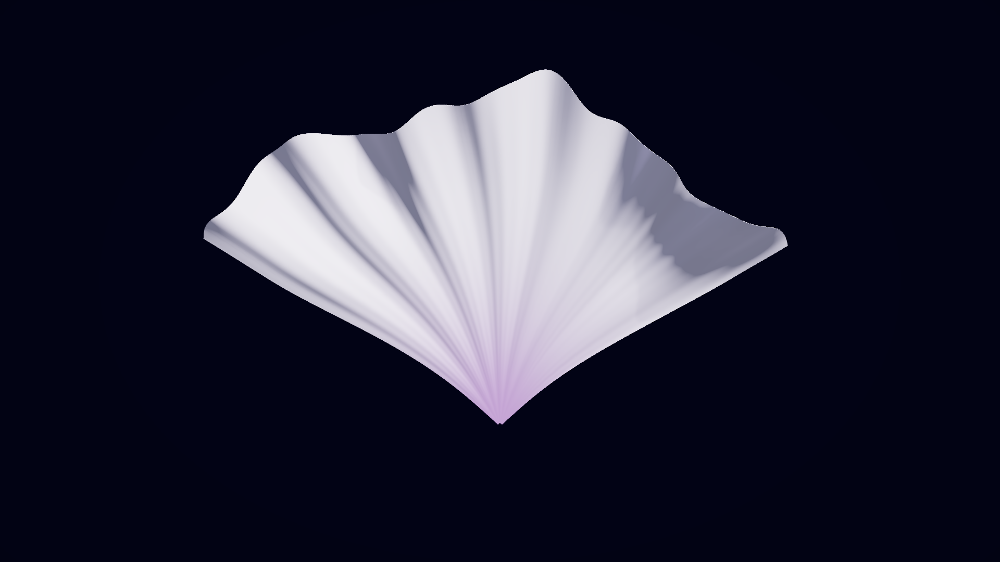
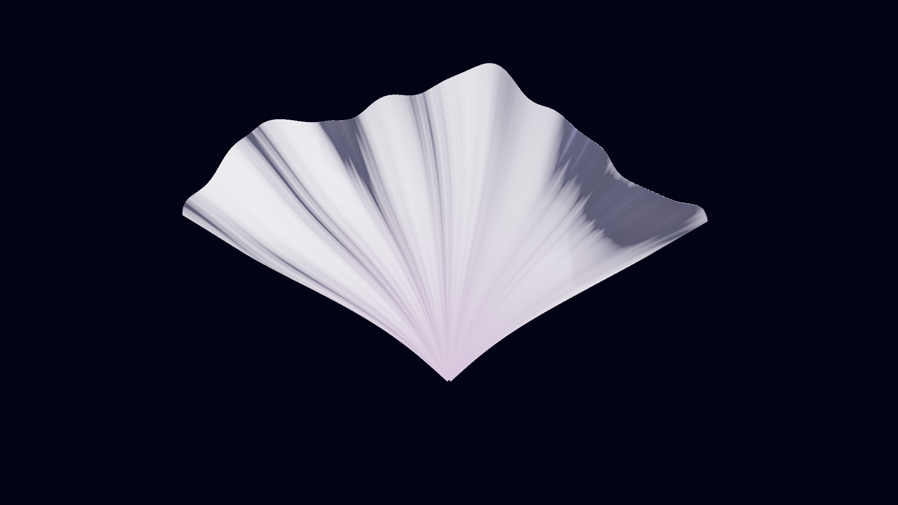
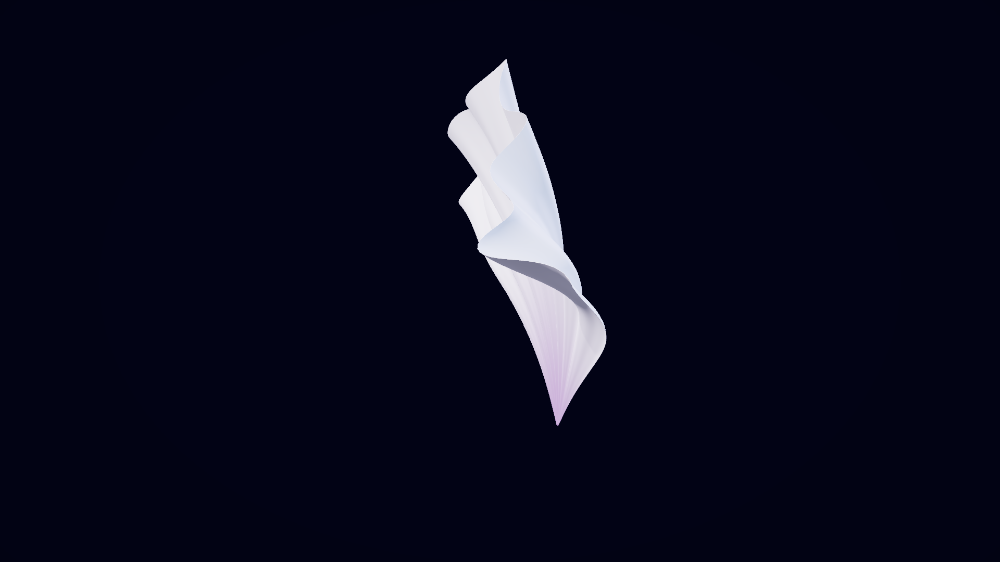
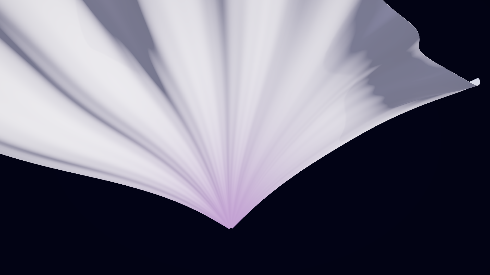
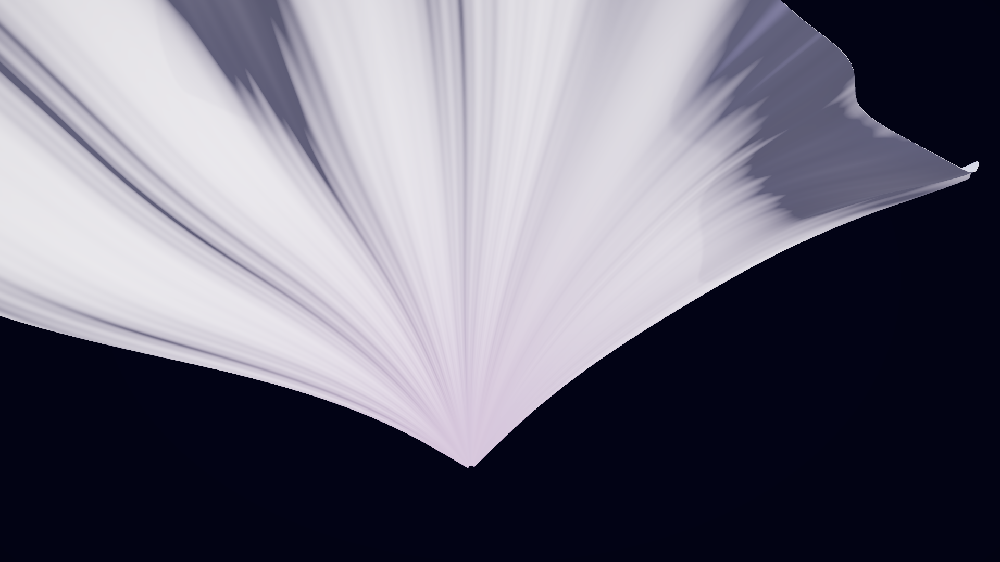

# 珍珠丝绸微细节 · A/B 与性能报告

日期：2026-10-29（香港时间）。工程：E:\Unity\MindState，Unity **2022.3.62f3c1 / Built-in**。

## 优化内容

- A 是保存的旧版 Shader、材质、单周期法线及 100% 主褶皱振幅；B 是当前优化材质及 80% 主褶皱振幅。
- B 使用离线生成的 1024² 非均匀放射法线：主细纹默认 32 条，含轻微弯曲、间距变化和弱二级纤维，保留 20–40 调整范围。
- 新增一张 1024² 线性打包遮罩，一次采样同时提供 Smoothness Variation、微弱淡粉色差、背光权重和局部细纹强度。材质纹理采样由 1 次增至 2 次；RGBA32 含 mipmap 的遮罩理论额外内存约 5.3 MiB。
- Smoothness 基准约 0.30，局部变化限制在约 ±0.06；降低均匀塑料高光，保留柔和掠射 sheen。恒定填充亮度降低，透光近似响应主光颜色、强度和背光方向。
- 保持 Opaque、ZWrite、前后表面法线与切线手性。使用 mipmap、Trilinear、8× 各向异性过滤；在根部、远景和掠射角减弱细纹，无负 mip bias。
- 网格、UV、外缘波浪、卷绕与翻折算法没有重构。主褶皱振幅仅乘以 0.8；无新增细分、微纹几何、CPU 网格更新、RecalculateNormals、物理模拟、粒子或 Brush Stamps。
- SetShapeParameters、SetBrainMetrics、脑电映射、冻结和重播控制保持兼容；七个相关方法与原始源代码逐段比对一致，记录见 InterfacePreservation.txt。

## 实际 A/B 截图

相机、灯光、曝光、分辨率及造型参数相同，Bloom 关闭，材质呼吸固定为 0。以下均为 Unity 实际相机渲染，不是概念图。

| 优化前 A | 优化后 B |
|---|---|
|  |  |
|  |  |
|  |  |

另有 A/B Gallery、Back 图片，B_FineCount_20 / 32 / 40，以及 B_Unfold_000 / 025 / 050 / 075 / 100 展开阶段截图。基线资源保存在 Baseline 目录与开发诊断 Resources 中，旧版 Evidence/FanPetal 未覆盖。

## Profiler 三轮对比

硬件：11th Gen Intel(R) Core(TM) i5-11600KF @ 3.90GHz；NVIDIA GeForce RTX 3080，Direct3D11。
同一 Windows x64 Development Build，1920×1080 离屏、4× MSAA，VSync 和限帧关闭，Deep Profile 关闭。

冻结／动态各三轮 A/B，每段先预热 10 秒、正式采样 60 秒，共 **12 段、720 秒正式采样**。轮换 A/B 顺序，动态使用相同的 1Hz 输入序列与展开重播规则。诊断每帧显式 Camera.Render，确实执行 GPU 渲染。

下表均值按三个采样段的有效帧数加权；P95 列是各轮独立 P95 的最小–最大范围，不是混合所有帧后重新计算的 P95。完整每轮均值/P95 见 ProfilerComparison.json，逐帧数据见 CSV。

| 场景 / 版本 | Main Thread 均值 ms | 各轮 P95 范围 ms | 花瓣更新均值 ms | Batches 均值 / 峰值 | 渲染顶点均值 / 峰值 | 花瓣 GC 峰值 B/帧 |
|---|---:|---:|---:|---:|---:|---:|
| 冻结 A | 0.5829 | 1.0267–1.0612 | 0.0016 | 9.000 / 9 | 152118 / 152118 | 0 |
| 冻结 B | 0.5884 | 1.0496–1.0797 | 0.0016 | 9.000 / 9 | 152118 / 152118 | 0 |
| 动态 A | 5.8308 | 6.3616–6.5321 | 5.1407 | 9.000 / 9 | 152118 / 152118 | 0 |
| 动态 B | 5.8203 | 6.3428–6.5115 | 5.1311 | 8.979 / 9 | 151658 / 152118 | 0 |

- 冻结 Main Thread 均值变化 **0.95%**；动态均值变化 **-0.18%**。均在约 5% 波动预算内，动态轻微负差异不应解释为确定的加速。
- 实际 Mesh 顶点数 **21,730 → 21,730**，三角形 **41,792 → 41,792**。
- 材质 Pass 数 **4 → 4**；Batches 峰值 **9 → 9**，未新增绘制批次。动态 B 的平均渲染数量略少；幅度微调改变了包围盒/可见范围，不能据此宣称渲染算法提速。
- 渲染顶点统计包含灯光、阴影等多次绘制，不能与实际 Mesh 的 21,730 顶点混为一谈。
- 花瓣更新的逐帧托管分配峰值保持 **0 字节**。GC 指标仅覆盖花瓣更新，不代表整个诊断、CSV/截图写入或操作面板均无分配。

### GPU / Render Thread 计时限制

播放器已启用 GPU Profiler，并采集可用计数器、FrameTimingManager 和 Camera.Render GPU recorder；随后又在指定版本的编辑器中显式开启 GPU Profiler 复查。编辑器报告 profileGPU=True、OS 和设备支持标志为 True、驱动未标记为 buggy。

但本次隐藏／离屏执行路径始终未返回有效 GPU 时间，独立 Render Thread 帧时间也未被填报。因此正式统计用 **-1 / 无有效样本** 表示，而非 0ms；不把 CPU 提交耗时替代为 GPU 时间，也不宣称验证了新增 GPU 耗时 ≤0.2ms 的预算。复查证据见 EditorGPUFinal/Capabilities.txt 和 ProfilerComparison.json。

## 回归与复现

原有 **97 项回归全部通过**：三参数 27 组 × 三个展开阶段的几何检查，以及输入、模式、平滑、冻结和兼容重播等。坐标、法线、绕序、包围盒检查通过，展开效果保留。详细记录和多视角截图在 Regression 子目录。

- 当前运行程序：Builds/Windows/MindState.exe。
- 重新构建：Tools/Build.ps1；需要重生成材质/纹理时加 -RecreateArt。
- A/B 对比：Tools/CompareSilk.ps1；默认三轮、每段 60 秒，-ScreensOnly 仅输出截图。
- 回归：Tools/Verify.ps1；本轮默认 10 秒附加运行，不重复完整 15 分钟长测。
- 四个代表性 .raw 文件可直接在 Unity Profiler 中 Load；完整 12 段 CSV 和每轮统计同时保留。
- BuildManifest.json 记录当前源码、美术资产与场景/Prefab 的 SHA-256。

本轮没有修改脑机接口或集成新设备/3D 屏幕。测试是单相机离屏结果，不能直接推算多视角屏幕开销；丝绸与薄片透光仍为低成本艺术近似。
